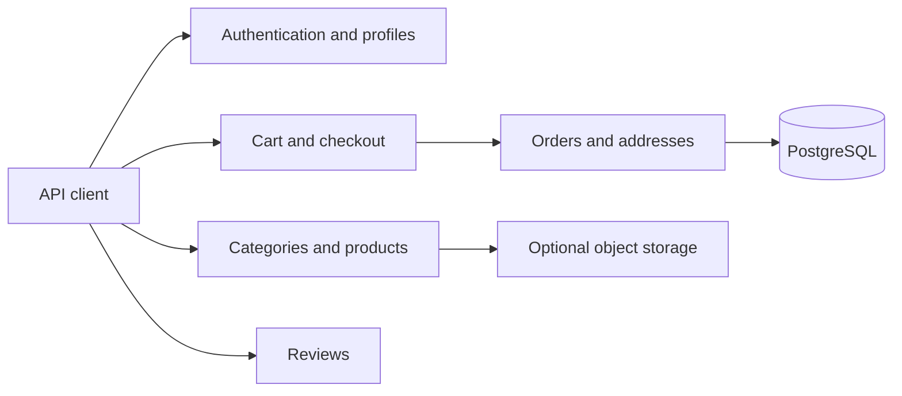

# Imtihon7 — Product Catalog and Ordering API

    

## Overview

Imtihon7 is a Django REST API for a product marketplace/order workflow. It includes authentication and profiles, categories and products, a user cart, order creation, addresses, and reviews. The current repository is backend-focused.

## Features

- Registration/authentication and account/profile endpoints.
- Product and category catalog endpoints.
- Cart management and checkout/order creation.
- Address and review resources.
- PostgreSQL-oriented persistence and migrations.
- OpenAPI schema, Swagger UI, and ReDoc routes.
- Storage configuration for S3-compatible object storage.

The checkout code coordinates order creation transactionally. The repository does not establish that an external payment gateway is configured or that production payment settlement is implemented.

## Screenshots

No product screenshots are tracked in this backend repository. Add real API documentation screenshots or a connected frontend when available; do not use generic mockups as evidence of a running UI.

## Technology stack

| Area | Technology |
|---|---|
| Backend | Python, Django, Django REST Framework |
| Authentication | SimpleJWT |
| API schema | drf-spectacular / OpenAPI |
| Database | PostgreSQL |
| Object storage | S3-compatible configuration |

## Architecture



The Django project separates functionality into apps for authentication, accounts, categories, products, cart, orders, addresses, reviews, and profiles. Django models and migrations provide the persistence layer.

## Repository layout

```text
authentication/  Authentication endpoints
accounts/        Account/profile workflows
categories/      Product category API
products/        Catalog and product API
cart/            Cart operations
orders/          Checkout and order lifecycle
addresses/       Customer addresses
reviews/         Product reviews
profiles/        Profile API
config/          Django settings and root URL configuration
```

## Installation

```bash
python -m venv .venv
source .venv/bin/activate
pip install -r requirements.txt
cp .env.example .env
python manage.py migrate
python manage.py runserver
```

Provision PostgreSQL before starting the application. Configure the storage and email integrations only if they are being used. The repository does not include a containerized production deployment recipe.

## Environment variables

The `.env.example` file lists the current settings. Supply private values through an untracked `.env` locally or a hosting secret manager.

| Variable group | Purpose |
|---|---|
| `SECRET_KEY`, `DEBUG`, allowed hosts | Django configuration |
| `DB_*` | PostgreSQL connection parameters |
| `SUPABASE_PROJECT_ID`, `AWS_*` | Optional storage configuration |
| `EMAIL_*` | Email backend settings |

The checked-in example contains values that resemble credentials. They are intentionally omitted here. Treat any value that was ever active as exposed and rotate it.

## API documentation

With the server running:

- Swagger UI: **`/api/docs/`**
- OpenAPI schema: **`/api/schema/`**
- ReDoc: **`/api/redoc/`**

The root API URLs mount auth, account, category, product, cart, order, address, review, and profile routes. Use the generated schema for exact paths and payloads.

## Database structure

The API stores users/accounts, category and product records, cart contents, orders, customer addresses, and reviews. Inspect the app model and migration files for exact constraints and relationships.

## Usage

1. Configure PostgreSQL and environment variables.
2. Run migrations and start the Django server.
3. Authenticate through the auth API, browse categories/products, update a cart, then submit the supported checkout workflow.
4. Use Swagger UI or ReDoc to inspect request and response schemas.

No sample credentials or private values are included in this README.

## Deployment

This repository has no confirmed live deployment or dedicated Railway/Vercel configuration. Deploy as a Django application with PostgreSQL, secure environment settings, an application server, and the chosen static/media storage backend. Add a deployment recipe and health check after the target platform is selected.

## Security notes

- Review `.env.example` for credential-like values. If any were active, rotate them and remove them from Git history as a separate security task.
- Set a unique production secret, `DEBUG=False`, and strict allowed hosts.
- Ensure checkout ownership and object-level permissions are enforced for carts, orders, and addresses.
- Validate uploaded media and restrict storage access.
- Do not describe order creation as payment settlement without a verified payment integration.

## Tests

Test files currently appear to be placeholder Django test modules rather than substantive coverage. No test result is claimed. Add tests for auth, permissions, cart ownership, concurrent checkout, order totals, and reviews before presenting the API as production-ready.

## Future improvements

- Add meaningful tests and CI, including checkout concurrency and object permissions.
- Sanitize credential-like values in `.env.example` and rotate any exposed active secrets.
- Add a concise English setup guide and example API requests/responses.
- Document and implement the actual payment boundary and deployment target.
